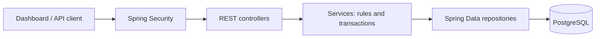

# Build specification

## Problem and scope

Build a small University Management System for CSE 3230 Lab 4. Admins manage university accounts and courses; teachers review assigned courses and students; students manage their own course registrations. All roles have a personal profile and university notice board.

The focus is REST conventions, backend design, Spring Security, persistent data, and a simple dashboard. Grades, attendance, fees, timetabling, and degree audits are outside this build. Enrollment credits are a current course total, not a transcript.

The implementation plan is in [DASHBOARD_PLAN.md](DASHBOARD_PLAN.md); verification results and limits are in [SETUP.md](SETUP.md).

## Role permissions

| Resource / action | Admin | Teacher | Student |
|---|---|---|---|
| Accounts | CRUD all three roles | Read/update own profile | Read/update own profile |
| Courses | CRUD; assign teacher | Read assigned courses | Read catalog |
| Enrollments | Read, enroll any student, withdraw | Read assigned course rosters | Read, enroll, withdraw self |
| Notices | CRUD | Read | Read |

Guests cannot access resource APIs. Same-role account IDs belonging to someone else return `404`; unrelated account collections return `403`. Teachers cannot browse the student directory, but can read names/emails in their assigned course rosters. Students cannot read classmates' enrollments. Direct API calls obey the same rules as the UI.

## Technology and design

Java 25 LTS, Spring Boot 3.5.16, Maven Wrapper, PostgreSQL 17, JPA, Flyway, and Spring Security. HTML/CSS/JavaScript are served by Spring Boot; no frontend toolchain is needed. Use [the shared IntelliJ Application configuration](INTELLIJ.md).

- **Layered architecture:** controllers own HTTP, services own business rules and transaction boundaries.
- **Repository:** Spring Data handles queries; course and final-admin writes use targeted pessimistic locks.
- **DTO:** request validation and explicit response fields keep entities and credentials out of public JSON.
- **Dependency injection:** constructor injection connects components.
- **Central error handling:** controller advice and security handlers return consistent JSON errors.

The three account controllers reuse `AccountService`; `AccountAccess` enforces role/ownership inside services. Course, enrollment, and notice services have separate responsibilities. Queries scope teacher/student data before serializing it; entity graphs load related records, and one aggregate query supplies course enrollment counts.

## Data model

| Table | Main fields and rules |
|---|---|
| `user_accounts` | Generated ID; trimmed name (2–100), normalized unique email (max 254), BCrypt hash, fixed role |
| `courses` | Generated ID; unique uppercase code (2–20), title (2–150), credits (1–6), capacity (1–200), teacher FK |
| `enrollments` | Generated ID; course FK, student FK, timestamp; unique `(course_id, student_id)` |
| `notices` | Generated ID; title (2–150), body (2–3000), publication timestamp, nullable author FK |

Database constraints enforce required fields, ranges, uniqueness, and references. Services ensure assigned accounts have the correct role. Foreign keys have supporting indexes. Flyway V1–V3 create/extend the schema; Hibernate validates it. Existing volumes and account passwords are preserved.

Enrollment locks the course row before checking capacity and inserting. Course edits/deletion use the same lock, preventing last-seat overbooking and capacity below enrollment count. Duplicate registration/full courses return `409`. A course with enrollments cannot be deleted. Withdraw/reassign dependencies before deleting student/teacher accounts. Notices survive author deletion and display “University office”.

## REST contract

**29 resource endpoints:** 15 account CRUD, 5 course CRUD, 4 enrollment, and 5 notice CRUD. Authentication has four additional routes.

| Resource | Collection | Record |
|---|---|---|
| Accounts: `admins`, `teachers`, `students` | `GET`, `POST /api/{resource}` | `GET`, `PUT`, `DELETE /api/{resource}/{id}` |
| Courses | `GET`, `POST /api/courses` | `GET`, `PUT`, `DELETE /api/courses/{id}` |
| Enrollments | `GET`, `POST /api/enrollments` | `GET`, `DELETE /api/enrollments/{id}` |
| Notices | `GET`, `POST /api/notices` | `GET`, `PUT`, `DELETE /api/notices/{id}` |

- Plural resource nouns; HTTP methods express operations. GET never changes data.
- JSON writes require `Content-Type: application/json`; unknown fields are rejected.
- POST returns `201 Created`, JSON, and `Location`. GET/PUT return `200` JSON. DELETE returns empty `204`.
- PUT requires all writable fields; omitted account password preserves the credential. Updates never create missing records. Notice edits preserve the original publication timestamp.
- Lists are JSON arrays. Accounts sort by ID; courses by code; enrollments newest ID first; notices newest publication/ID first.
- Missing or private IDs return `404`. Repeated DELETE returns `404` while the record remains absent.

These choices follow [HTTP semantics](https://www.rfc-editor.org/rfc/rfc9110.html#section-9). Request examples and response fields are in [API.md](API.md).

| Error | Meaning |
|---|---|
| `400` | Invalid JSON/fields, invalid teacher/student assignment |
| `401` | Missing/expired session or incorrect login |
| `403` | Role denial, attempted student impersonation, invalid/missing CSRF |
| `404` | Missing/private record |
| `405` | Unsupported method, with `Allow` header |
| `409` | Duplicate email/code/enrollment, full course, dependency, capacity conflict, final-admin deletion |
| `415` | Unsupported content type |

Errors contain `status`, `code`, `message`, and optional validation `fields`.

## Authentication and safety

| Route | Contract |
|---|---|
| `GET /api/auth/csrf` | Public token and header name |
| `POST /api/auth/login` | Form-encoded email/password; JSON identity and session cookie |
| `GET /api/auth/me` | Authenticated identity |
| `POST /api/auth/logout` | Empty `204`; invalidates session and removes cookie |

All writes, including login/logout, require CSRF. Fetch a fresh token after login/logout. Sessions expire after 30 idle minutes; cookies are `HttpOnly` / `SameSite=Lax`. Deleted accounts lose access on their next protected request. At least one admin must remain, including under concurrent deletion.

Passwords require 8 characters and at most 72 UTF-8 bytes. They are write-only and stored as BCrypt hashes. No password/hash is returned in resource responses. Configuration lives in ignored `.env`; examples are in `.env.example`.

The default `demo` profile seeds three accounts, three courses, one enrollment, and one notice **only when the account table is empty**. Existing databases are migrated without adding sample academic records or resetting user changes. An explicit non-demo profile disables seeding.

## Dashboard and startup

A shared responsive sidebar provides Overview, Courses, role-specific People/Enrollments, Notice board, and My profile. Summary cards show real data; lists support search and course filters. Forms have labels/validation, destructive operations require confirmation, and loading/empty/success/error states are visible. Content uses DOM text nodes rather than HTML interpolation.

IntelliJ runs `UniversityManagementApplication.main()` with project-root working directory. Docker Compose supplies PostgreSQL at `localhost:15432`; the app is at `localhost:8080`. Optional pgAdmin is at `localhost:5050`, with a pre-registered server on fresh volumes. The multi-stage Dockerfile builds and runs on Java 25 as a non-root user. [Run guide](INTELLIJ.md) · [Database guide](DATABASE.md).
