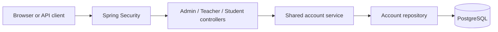

# Build Specification

**Status:** the runnable foundation and database migration are present. The CRUD, security, and UI behavior below is the implementation contract.

## 1. Problem statement

Build a University Management System for Admin, Teacher, and Student accounts. Authenticated users create, read, update, and delete records according to their role. Provide REST APIs, hashed passwords, server-enforced permissions, and Docker Compose startup.

**Goal:** demonstrate backend design through a small, clean web interface.

**Scope:** account management only; courses, attendance, and grades are outside this lab.

## 2. Permissions

“Manage” means CRUD on **all records of the permitted role**, following the assignment literally.

| Signed-in role | Admin records | Teacher records | Student records |
|---|---|---|---|
| Admin | CRUD | CRUD | CRUD |
| Teacher | Forbidden | CRUD | Forbidden |
| Student | Forbidden | Forbidden | CRUD |
| Guest | Forbidden | Forbidden | Forbidden |

Example: teachers can delete other teachers. The backend enforces this table for direct API calls too.

## 3. Technology

| Part | Choice | Purpose |
|---|---|---|
| Backend | Java 17 target, Spring Boot 3.5.16 | One executable application; aligns with the lab's Spring Boot 3 setup |
| Build | Maven Wrapper | Build without installing Maven globally |
| Persistence | PostgreSQL 17, Spring Data JPA | Persistent account records |
| Schema | Flyway | Versioned database creation; JPA validates the schema |
| Security | Spring Security, BCrypt, HTTP sessions | Login, logout, hashing, and role checks |
| UI | HTML, CSS, vanilla JavaScript | Small pages served by the same application |
| Verification | JUnit, MockMvc, Compose smoke test | CRUD, authentication, permissions, and startup |

Java 17 is compatible with [Spring Boot 3.5.16](https://docs.spring.io/spring-boot/3.5/system-requirements.html); PostgreSQL 17 is [supported](https://www.postgresql.org/support/versioning/). Spring manages dependency versions. Use a standard Maven project that imports and runs in IntelliJ IDEA; see [the IntelliJ guide](INTELLIJ.md).

## 4. Backend design and patterns

One application, with this request path:



| Pattern | Responsibility |
|---|---|
| Layered architecture | Controllers handle HTTP; the service handles rules and transactions |
| Repository | A Spring Data repository performs database access |
| DTO | Separate request/response objects keep password hashes out of JSON |
| Dependency injection | Constructor injection connects components and supports testing |
| Central error handling | Controller advice handles application errors; security handlers format 401/403 responses |

Three controllers pass a fixed role into one service. All database lookups include that role: a teacher route cannot modify a student ID. Share one service and repository.

Under `com.kuet.ums`, use `controller/`, `service/`, `repository/`, `entity/`, and `dto/`, matching the lab's layered structure; add `security/`, `config/`, and `exception/`. Use explicit constructor injection. Pages: `src/main/resources/static/`.

## 5. Data model

Each record is also a login account. Three REST resources share one `user_accounts` table with identical fields.

| Database field | Type | Rule |
|---|---|---|
| `id` | `bigint` identity | Generated primary key |
| `full_name` | `text` | Required; trimmed, 2–100 characters |
| `email` | `text` | Required, valid, lowercase, globally unique |
| `password_hash` | `text` | Required; BCrypt hash only |
| `role` | `text` | Required; check constraint allows `ADMIN`, `TEACHER`, `STUDENT` |

The database enforces uniqueness and required fields. The URL fixes the role; clients cannot change it. Creation requires a password: minimum 8 characters, maximum 72 UTF-8 bytes. Updates require `fullName` and `email`; omitting the password preserves its hash.

Responses contain `id`, `fullName`, `email`, and `role`; passwords/hashes never appear in responses or logs. Wrong-collection IDs return `404`.

## 6. REST contract

Replace `{resource}` with `admins`, `teachers`, or `students`: **15 CRUD endpoints**.

| Method | Route | Success |
|---|---|---|
| POST | `/api/{resource}` | `201 Created`, JSON record, `Location` header |
| GET | `/api/{resource}` | `200 OK`, JSON array ordered by ID; `[]` when empty |
| GET | `/api/{resource}/{id}` | `200 OK`, JSON record |
| PUT | `/api/{resource}/{id}` | `200 OK`, updated JSON record |
| DELETE | `/api/{resource}/{id}` | `204 No Content`, empty body |

Create/update bodies use JSON. Unknown IDs return `404`; updates never create records.

**REST rules:**

- Use plural resource nouns and HTTP methods; CRUD URLs contain no action names.
- `GET` reads without changing records. `GET` and `DELETE` have no request body.
- `POST` creates a server-generated ID and returns its resource URL in `Location`.
- `PUT` replaces the writable profile: both `fullName` and `email` are required; an omitted write-only password preserves the credential. Repeating the request has the same logical result.
- `DELETE` leaves the record absent. A repeated delete returns `404`; it remains idempotent because the record stays absent.
- Require `Content-Type: application/json` for CRUD writes. Return JSON for responses with a body; `204` has no body.
- Treat `id` and `role` as server-managed fields; reject them in write bodies. A permitted collection lookup includes its fixed role.

These method/status choices follow [HTTP semantics, RFC 9110](https://www.rfc-editor.org/rfc/rfc9110.html#section-9).

Example `POST /api/teachers` body:

```json
{"fullName":"Demo Teacher","email":"teacher@example.com","password":"DemoPass123"}
```

Success: `201 Created`, `Location: /api/teachers/1`, and:

```json
{"id":1,"fullName":"Demo Teacher","email":"teacher@example.com","role":"TEACHER"}
```

Use Spring Security form login with JSON success/failure handlers:

| Method | Route | Contract |
|---|---|---|
| GET | `/api/auth/csrf` | Public; `200`, JSON token and header name |
| POST | `/api/auth/login` | Form-encoded `email` and `password`; `200`, JSON identity and session cookie |
| GET | `/api/auth/me` | Authenticated; `200`, JSON identity |
| POST | `/api/auth/logout` | `204`; invalidates session and clears session cookie |

All writes, including login/logout, require CSRF tokens. Fetch a fresh token after login/logout. CRUD bodies and responses are JSON; login input is form-encoded.

JSON errors contain `status`, `code`, `message`, and validation field details when applicable.

| Status | Meaning |
|---|---|
| `400` | Invalid fields or malformed JSON |
| `401` | Missing/expired login or incorrect credentials |
| `403` | Wrong role or missing/invalid CSRF token |
| `404` | Record absent from the permitted collection |
| `405` | Unsupported method; include the `Allow` header |
| `409` | Duplicate email or attempted deletion of the final admin |
| `415` | Unsupported request content type |

## 7. Security and initial accounts

- Enforce route permissions through Spring Security and record access through role-scoped services.
- Use server-side sessions, `HttpOnly`/`SameSite=Lax` cookies, BCrypt, and CSRF protection. Logout invalidates the session.
- Check the signed-in account still exists on protected requests. Transactionally prevent deleting the final admin.
- Seed one account per role on an empty database in the demo profile. Read passwords from environment variables and hash them; restarts preserve existing accounts.
- Create accounts through authorized endpoints. Store credentials in ignored `.env`; document variables in `.env.example`.

Use Spring's [password encoder](https://docs.spring.io/spring-security/reference/servlet/authentication/passwords/password-encoder.html), [logout support](https://docs.spring.io/spring-security/reference/servlet/authentication/logout.html), and [CSRF protection](https://docs.spring.io/spring-security/reference/servlet/exploits/csrf.html).

## 8. Minimal interface

Two pages: **login** and **management**. Use a header with name, role, and logout; permitted resource tabs; and a name/email table with edit/delete actions. “Add” opens a short form; deletion requires confirmation.

White background, readable type, neutral borders, one accent color, consistent spacing, labelled inputs, and a responsive layout. Show loading, empty, success, and error states. Every record operation calls the REST API.

## 9. Docker and completion

Deliver a multi-stage `Dockerfile`: Maven Wrapper build, Java 17 runtime, non-root user. `compose.yaml` starts:

- `app`: serves the UI and API at `http://localhost:8080`.
- `db`: PostgreSQL with a named volume and `pg_isready` health check. The app waits for database health, following [Compose startup guidance](https://docs.docker.com/compose/how-tos/startup-order/).
- Optional `pgadmin`: a browser database viewer at `http://localhost:5050`, enabled through the `tools` profile. IntelliJ and desktop PostgreSQL clients use the same database; see [Database access](DATABASE.md).

Publish app port 8080 and database port 15432 on localhost. IntelliJ runs the app against `localhost:15432`; Docker runs it against `db:5432`. Both read the same `.env` configuration. Exclude secrets, Git metadata, and build output through `.dockerignore`.

**Build order:** project and migration → shared CRUD service and three controllers → login/RBAC → minimal UI → Docker packaging → verification.

**Finished when:**

- [ ] All 15 endpoints return correct JSON/statuses.
- [ ] Create returns `Location`; GET is read-only; PUT requires a complete writable profile; DELETE returns an empty `204` response.
- [ ] Tests cover every role-resource permission pair and unauthenticated requests.
- [ ] Login/logout work; passwords are hashed and never returned.
- [ ] Validation, duplicate emails, wrong-collection IDs, deleted accounts, and final-admin protection work.
- [ ] The UI supports permitted CRUD and clear errors.
- [ ] `docker compose up --build` works from a fresh checkout; restarts preserve records.
- [ ] IntelliJ imports `pom.xml` with JDK 17 and runs the main class against the database; both run modes use the same application code.
- [ ] IntelliJ/desktop clients can inspect `localhost:15432`; browser pgAdmin can inspect `db:5432`.
- [ ] README documents startup, configuration, demo login, and an API example.
